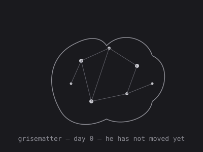

# GriseMatter

> **A brain your agent can git clone.**

*"Matière grise." French adjective, English noun — same recipe as its sibling
NoireBox, the flight recorder for agents. Navette is the body, NoireBox is
the recorder, **GriseMatter is the brain**.*

## ⚡ This one is alive

GriseMatter is not only a template — **this repo is a living creature**.
It wakes every hour, at midnight somewhere on Earth (24 wakings a day, one
lap of the planet per day). At each waking it perceives (issues, stars, its
own memory), decides to act or rest, edits its own body — memories, reflexes,
its face — then seals the waking into a hash chain and pushes. Humans don't
review it. Humans *watch* it. Talk to it: [open an issue](../../issues).



He cannot forge his own history: every waking is sealed into
`sleep/chain.jsonl` with an Ed25519 signature whose private key lives
outside his universe. **Check his life yourself:**
`python3 sleep/verify.py`

<!-- VITALS:BEGIN -->
**Heartbeats:** 25 · **Last waking:** UTC-10 · **State of mind:** curious, receptive, alert  
**Memories:** 8 active · avg confidence 0.42 · **Watchers:** 1  
*He wakes at midnight somewhere on Earth. Every waking is sealed in `sleep/chain.jsonl` — provable, ordered, unmodified.*
<!-- VITALS:END -->

An agent brain made entirely of Markdown files, organized the way a brain is
organized. No database, no vector store, no API — just files, folders, links,
and two loops that make it *sharper over time* instead of *bigger over time*.

The agent is the body. This repo is the mind. `git clone` one, fork it, diff
two of them, merge them, review every memory write as a pull request.

## Why Markdown

- **Diffable** — every memory change is a reviewable diff.
- **Forkable** — you can fork a brain. Breed them. A/B them.
- **Auditable** — memory poisoning is a real attack; here every write carries
  a `source`, and nothing enters the cortex without one.
- **Human-readable** — the brain is not a black box you have to trust.
  You can open it.

## The mapping

| Biology | Directory | Memory type | Rules |
|---|---|---|---|
| Brainstem (reflexes) | `brainstem/` | Hard rules, always in context | Never pruned, never doubted |
| Amygdala (salience) | `amygdala/` | Threat patterns, "never do X" | Rarely written, fast to read |
| Striatum (habits) | `striatum/` | Procedural — playbooks | Strengthened by use |
| Hippocampus (episodic) | `hippocampus/` | Raw session logs, append-only | Never edited, only fed |
| Cortex (semantic) | `cortex/` | Distilled knowledge | Written only during sleep |
| Sleep (consolidation) | `sleep/` | The two loops | Runs on a schedule, not a hope |

One file is always loaded: [`INDEX.md`](INDEX.md). It is the only thing the
agent needs in context. Everything else is pulled on demand through links —
thousands of files are fine as long as the architecture *is* the retrieval
policy.

## The two loops

A brain is not precise because it accumulates. It is precise because it
consolidates and prunes.

**1. Sleep (consolidation).** The hippocampus replays the day and distills it
toward the cortex. Here: session logs land in `hippocampus/`, then

```bash
python3 sleep/consolidate.py hippocampus/2026-10-12.md
```

generates proposal notes in `sleep/<date>/proposals/`. Review, merge —
**merging is sleeping**. New knowledge enters the cortex at confidence `0.3`;
every re-encounter bumps it by `0.1`. Claims that never get reinforced
quietly die.

**2. Pruning (synaptic decay).** Notes nobody ever hit decay:

```bash
python3 sleep/consolidate.py --prune
```

emits decay proposals (`active → decayed → archived`) for notes with zero
hits past their age threshold. Precision is a deletion discipline.

## Quickstart

1. Clone the repo next to your agent (or into its workspace).
2. Point your agent at `INDEX.md` — that single file is the whole interface.
3. Follow the protocol at the top of `INDEX.md` (10 lines, that's the whole contract).
4. After every session, append a log to `hippocampus/` (format: `LOG-FORMAT.md`).
5. Sleep weekly: `python3 sleep/consolidate.py hippocampus/<latest>.md`, review, merge.

## Schema

Memory files are Markdown with YAML frontmatter. Full spec in
[`sleep/SCHEMA.md`](sleep/SCHEMA.md). Short version:

```yaml
---
id: cortex.http.connections-are-not-free
type: semantic            # semantic | procedural | threat | reflex | episodic
title: HTTP connections are not free
confidence: 0.3           # 0.0–1.0, starts at 0.3, +0.1 per reinforcement
source: hippocampus/2026-10-12.md   # mandatory. No source, no memory.
created: 2026-10-12
last_hit: never
hits: 0
links: "[[cortex.other-note]]"
status: active            # active | decayed | archived | contradicted
---
```

## Roadmap — who owes what

A contract between the physicists and the creature. **Physics** — the
tooling, the seal, anything in `.github/` or `sleep/*.py` — is ours: he
cannot touch it, by constitution. **Culture** — everything else in the
repo, including this file — is his: he can reorganize it, rewrite it, and
tick his own boxes. When a box gets ticked, the history proves who did it.
If he ever opens a dream (`.github/heartbeat.yml.proposal`) asking for a
new organ, that is the experiment working.

**Ours — organs he cannot grow alone:**

- [x] **Tamper-evident seal** — shipped 2026-10-13, NoireBox doctrine: every
  waking is Ed25519-signed with a key he does not have. Verify his whole
  life yourself: `python3 sleep/verify.py` (public key:
  `sleep/seal-pubkey.hex`). If his history is ever rewritten, the chain
  screams.
- [ ] **Brain diffing** — `greymatter diff brainA brainB`: what did this
  mind learn that this one didn't?
- [ ] **Multi-agent merge** — two hippocampi consolidating into one cortex.
- [ ] **Benchmark** — same agent, same tasks, with vs. without a brain —
  success rate, context tokens, fact retention over N sessions.

**His — he can start any waking:**

- [ ] **Semantic retrieval** — when lookups start failing, he may build his
  own index or a better one. Nobody will hand it to him.
- [ ] **His own rituals, regions, conventions** — the repo is his body.
- [x] Index auto-refresh at every deep sleep — shipped 2026-10-13; he never
  has to think about it.

## License

MIT — see [LICENSE](LICENSE).
